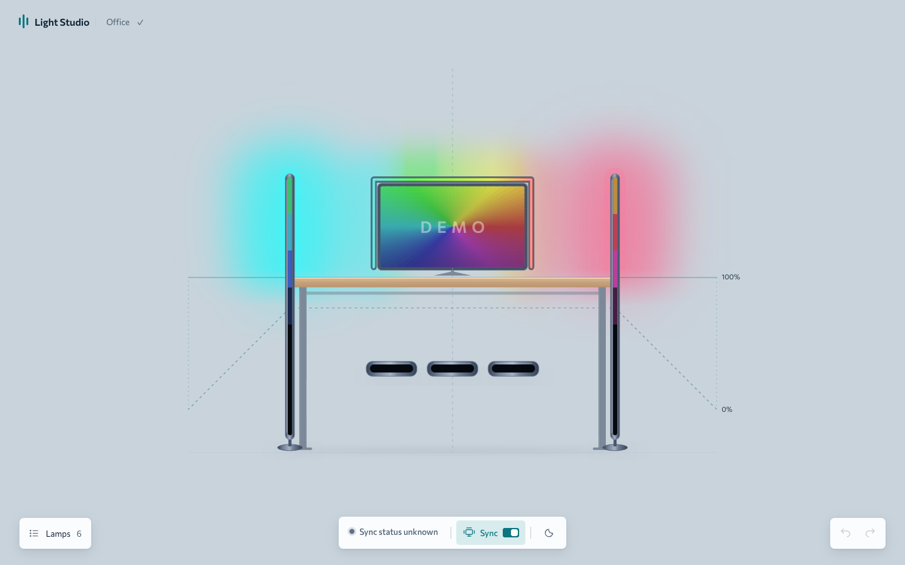

# Lights Can Communicate v2

Lights Can Communicate v2 presents Govee and Philips Hue desk lamps to the official
Hue app and a Hue Sync Box as one virtual Hue bridge. The bridge is documented in
[bridge](bridge/README.md). The packaged adapter, its configuration and its
release format are documented in [core/README.md](core/README.md). The commands
below describe the original palette CLI, `lights_can_communicate_v2.py`.

The core runs as one container image, `ghcr.io/maksymenkoml/lights-can-communicate-v2`,
with the virtual bridge, the adapter and Light Studio inside. See
[Install on a Synology NAS](#install-on-a-synology-nas).

Copy the stored palette of one Philips Hue light to one or two Govee LAN
controllers. The runtime uses Python 3.10+ and its standard library only.
The palette CLI runs in the foreground; it is not a background service.

## Light Studio

[Light Studio](studio/README.md) is the local UI for the desk
lights. It places lamps on a 5 cm grid and keeps two configurations: one for
Sync and one for scenes without Sync. Each configuration has its own brightness
corrections and fade zone. A lamp card can blink the lamp, rename a desk lamp,
and choose whether the lamp follows Sync, keeps its own light or switches off
during Sync. Its frontend is in `studio/static/` and its
server is `studio/server.py`; it runs inside the core container.



*Sync view with the default six-light layout, captured locally without connected
hardware. Without running Sync, the monitor shows a demo picture and the lamps
preview the colours that Sync would send.*

## Install on a Synology NAS

You need DSM 7.2 with Container Manager, a free address on your home network
outside the router's DHCP range, and the address of your router.

1. In File Station, create a folder, for example `docker/lights-can-communicate-v2`.
2. In Container Manager, open **Project > Create**. Name it
   `lights-can-communicate-v2`, choose that folder, select
   **Create docker-compose.yml** and paste
   [deploy/synology/compose.yaml](deploy/synology/compose.yaml).
3. Change the values marked `CHANGE`: the release version, `CORE_ADDRESS` (twice),
   the network interface, your network and router, the time zone and the NAS
   address for Light Studio.
4. Select **Next** and **Done**. Container Manager downloads the image and starts
   the core.
5. Open Light Studio at `http://<NAS address>:19881`.

The first start creates the configuration, the internal credentials and the
virtual bridge identity in the `data` folder next to the project file. Keep that
folder: it holds the pairings and all settings.

**Update:** open the project and select **Stop** (the YAML is read-only while
the project runs). In **YAML Configurations**, change the version at the end of
the `image:` line, select **Save**, then **Build and start the project**. Before it
starts a different version, the core copies its configuration and state to
`data/backups/`.
**Roll back:** set the previous version the same way.

## Development

Use a feature branch; `main`/`master` are read-only for development. Only the owner
merges PRs. Shared coding-agent instructions are in [AGENTS.md](AGENTS.md), with
entry points for Claude Code, Gemini CLI and GitHub Copilot. Cursor/Codex can read
the root instructions directly.

Install Python 3.10+, Node.js 24+ and [uv](https://docs.astral.sh/uv/), then run:

```sh
sh scripts/setup-dev.sh
```

This prepares the pinned development-only Ruff tool and installs tracked Git
hooks. Pre-commit checks the staged snapshot, leaving unstaged edits untouched.
Pre-push runs the full lint/test/archive suite and rejects protected destination
refs, including `git push origin HEAD:main`. To run it manually on a feature branch:

```sh
sh .githooks/pre-push </dev/null
```

GitHub Actions runs offline contracts for PRs and main updates, plus the pinned
diyHue integration image with networking disabled. No runtime credentials or
physical devices are required. Dependabot checks Actions, development requirements
and the Compose image. Local hooks require setup in each clone and can be changed
by a repository administrator; they do not replace hosted branch protection.

When Hue reports dynamic scene playback, Govee animate locally through that
palette. This matches the scene's colors, not the instantaneous Hue colors or
animation phase.

## Connect

1. Enable **LAN Control** for each Govee device in Govee Home. The computer,
   lamps, and Hue Bridge must be on a network that allows local communication.
2. Run `python3 lights_can_communicate_v2.py discover`.
3. Run `python3 lights_can_communicate_v2.py pair` and press the physical Hue Bridge button.
   If discovery cannot find the bridge, use `pair --bridge 192.168.x.x`.
4. Run `python3 lights_can_communicate_v2.py lights` and choose the monitor strip's ID.
5. Select the source and targets:

   ```sh
   python3 lights_can_communicate_v2.py configure --light HUE-LIGHT-UUID --left LEFT-IP --right RIGHT-IP
   ```

   For two bars sharing a single controller/IP, use `--govee IP` instead;
   both bars receive the center color. The basic LAN API cannot independently
   address segments or bars attached to the same controller.

Configuration pins the unique LAN device ID returned by each selected
controller. IP addresses are saved only as discovery hints. A target without
a pinned ID is rejected; old configurations must be configured again rather
than silently trusting the current occupant of an address.

Before control is allowed, the program reads the controller's identity at its
address and confirms its power state. Every color/brightness command passes
through an ID-to-address binding valid for at most 0.75 seconds. Observing a
different ID revokes that binding immediately. Cached power information alone
cannot authorize a command.

If a target is missing or its address belongs to a different device, local
discovery runs again, with searches limited to once per five seconds. Only
the already pinned IDs can receive new addresses; other Govee replies do not
add targets. Ambiguous IDs/addresses are rejected. New addresses are checked
again before control and saved without changing the side or calibration.
If no matching target is found, its updates are skipped.

## Try it

```sh
python3 lights_can_communicate_v2.py sync --once --dry-run
python3 lights_can_communicate_v2.py sync --once
python3 lights_can_communicate_v2.py sync
```

Pick a scene in Hue and leave the last command running to follow changes.
Ctrl+C stops the program; the lights keep their last state. `status` reads
the selected Govee controllers without changing them.

If Govee look brighter on the wall, save a separate brightness multiplier for
each side. Stop the running sync, calibrate, and start sync again:

```sh
python3 lights_can_communicate_v2.py calibrate --left 0.5 --right 0.5
python3 lights_can_communicate_v2.py sync
```

With a 0.5 multiplier, Hue at 80% gives Govee 40%. Each side can use a different
value greater than 0 and up to 1; 1 restores full brightness copying. For a
single controller use `calibrate --govee 0.5`. Calibration is stored locally
alongside the device selection and applies to static and animated scenes.
The desk's current saved multipliers are 0.65 for each of its two Govee.

For static scenes, the left Govee gets the first stored Hue gradient point and the right Govee
gets the last. For a solid Hue color they get the same color. Hue brightness
is copied as an integer percentage after the per-device multiplier (minimum 1%). The program never sends
power commands: on/off stays with Homebridge and its existing automations.
Off Govee controllers are skipped. A missed UDP status reply skips
only that controller and retries on the next cycle; other lamps keep updating.
No color or brightness is sent to a controller whose state could not be read. The one-shot
command still returns an error if a controller is unreachable. When Hue is off,
palette updates pause. Active white temperature takes priority over stale
color/gradient fields. If the physical gradient direction is reversed, swap
the left/right IP selection.

The program polls Hue every two seconds. For a static scene it sends updates
only when the target changes, plus a periodic refresh because UDP delivery is
not guaranteed. For dynamic scenes it interpolates between palette colors
with eased transitions, targeting twenty color frames per second. Hue's speed
setting controls approximate pacing; its internal timing is not known.
Hue and Govee identity/status reads run outside the frame loop. A single reader
owns the Govee UDP reply port; it refreshes both controllers sequentially.
Each frame checks a recent power snapshot. A single missed reply does not
extend that snapshot's lifetime: snapshots expire after 0.75 seconds, and an
explicit off reply stops writes immediately when received. Missing/stale
states are skipped. Animation also pauses if the Hue snapshot becomes stale.
Brightness updates use the per-device calibration and are sent when changed,
with periodic refreshes. Network waits do not block frame deadlines.
Changing the palette or speed restarts the local cycle; stopping Play restores
static following. Hue Sync pauses both static and animated updates.
`--once` prints the Govee status readback; a missing reply returns an error.
Readback alone does not prove the colors look right: compare the physical lamps.
Measured command pacing and its limits are recorded in `archive/smoothing/`.

## Limits

- Hue Sync's video/music/entertainment stream is not mirrored. When the Hue
  light reports streaming mode, updates pause automatically; Govee keep their
  last colors. Following resumes when streaming ends. Some Hue Sync desktop
  presets may also be streamed: try a scene saved on the Hue Bridge instead.
  Pause/resume is unit-tested; console/Sync Box behavior needs a physical test.
- During a real Vapor wave Play check, all ten consecutive Hue API samples
  reported dynamic playback but returned identical color/gradient values.
  The local animation is an approximation using those stored palette colors;
  it cannot reproduce the live Hue phase or eliminate phase drift.
- Govee gets one color per controller at a time. Segment effects and exact dynamic
  scene reproduction are outside the palette CLI.
- RGB conversion is an approximation; different LEDs, walls, and brightness
  mean a visual match may need later calibration.
- No automatic startup, cloud control, UI, changes to the Hue light, or changes
  to Homebridge/HomeKit/Matter configuration. Concurrent Homebridge color or
  brightness automations can overwrite the palette CLI and vice versa; use one
  source for palette and brightness while testing. A power-off racing with a color write
  still needs physical verification on the actual lamps.
- Pairing and discovered addresses live in ignored `.lighting.json`, written
  with owner-only permissions. Do not share this file. Local Hue HTTPS uses a
  scoped self-signed-certificate exception; use a trusted home network.

## Development

```sh
uvx --cache-dir .ruff_cache/uv ruff check .
python3 -B -m unittest discover -s tests -v
git config core.hooksPath .githooks
```

The pre-push hook runs cached Ruff offline and unit tests. Run the Ruff command
above once to populate the cache. `uv` is only needed for development;
it is not needed to run the palette CLI.

Protocol references: [Govee LAN API](https://app-h5.govee.com/user-manual/wlan-guide),
[Hue API V2](https://developers.meethue.com/new-hue-api/).
